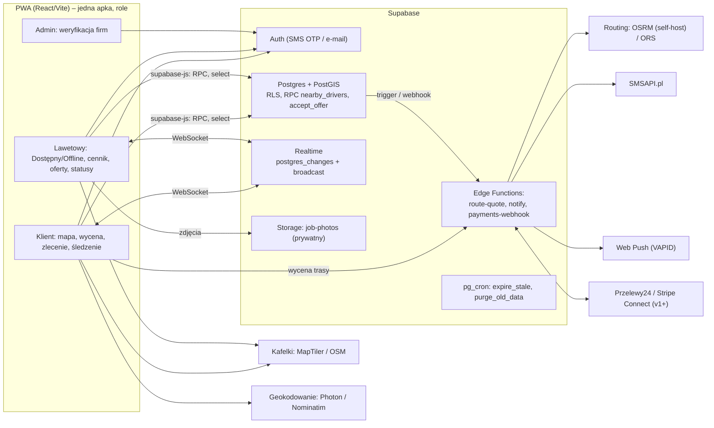

# 03 — Architektura docelowa „Uber dla lawet”

Stack (wymóg Lovable): **React + Vite + TypeScript + Tailwind + shadcn/ui** oraz **Supabase** (Postgres + PostGIS, Auth, Realtime, Storage, Edge Functions). Jedna aplikacja PWA, role `client` / `driver` / `admin`. Pełny SQL: [`supabase/migrations/0001_init.sql`](../supabase/migrations/0001_init.sql). Migracja została przetestowana lokalnie na Postgres 16 + PostGIS 3 z zaślepkami `auth`/`storage`.

> Ceny usług zewnętrznych są orientacyjne (stan na 2026). Przed decyzją sprawdź aktualne cenniki.

---

## 1. Architektura high-level



### Mapy

| Opcja | Koszt | Uwagi |
|---|---|---|
| **Leaflet + MapTiler** (rekomendacja MVP/v1) | Leaflet: darmowy. MapTiler: plan Free tylko niekomercyjnie, płatne od ok. 25 USD/mies. | `react-leaflet`, lekkie, OSM-owe dane wystarczające w PL. Później można przejść na MapLibre GL (wektory) bez zmiany dostawcy. |
| Kafelki `tile.openstreetmap.org` | 0 zł | **Tylko dev/demo.** Polityka OSMF zabrania intensywnego ruchu komercyjnego. |
| Mapbox GL | ok. 50 tys. ładowań/mies. za darmo, potem ok. 5 USD/1000 | Ładne, ale vendor lock-in i własna licencja SDK. |
| Google Maps JS | ok. 10 tys. ładowań/mies. za darmo, potem ok. 7 USD/1000 | Najlepsze POI i Street View, najdroższe przy skali. |

**Decyzja:** Leaflet + MapTiler (w dev OSM). Komponent mapy owinięty w `MapView` z adapterem, więc zmiana dostawcy to zmiana jednego pliku.

### Routing / ETA

| Opcja | Koszt | Uwagi |
|---|---|---|
| **OSRM self-host (extract Polski z Geofabrik)** | VPS 8 GB RAM, ok. 15–30 EUR/mies. | Bardzo szybki `/route` i `/table` (macierz), bez limitów. Profil `car`. Nie uwzględnia ograniczeń dla ciężkich zestawów. |
| OpenRouteService API | Free: ok. 2000 tras/dzień, ok. 500 macierzy/dzień | Dobry na MVP. Ma profil `driving-hgv` (przydatny dla lawet ciężkich). |
| Publiczny demo OSRM | 0 zł | Bez SLA, nie na produkcję. |
| Google Routes (Distance Matrix) | ok. 5–10 USD/1000 elementów | Ruch drogowy na żywo, najlepsze ETA, ale koszt rośnie z N kierowców × zapytania. |

**Decyzja:** dwustopniowo. (1) `nearby_drivers` w PostGIS liczy szybki szacunek: linia prosta × 1,3 i 45 km/h. (2) Edge Function `route-quote` dla top 5 kierowców i trasy odbiór→cel woła **ORS w MVP**, a od v1 **własny OSRM** (`/table`). Wynik `route_km` zapisujemy w `jobs`, a cenę blokuje serwer. Google Routes dopiero gdy ETA z ruchem stanie się przewagą biznesową.

### Geokodowanie (PL)

- **Photon** (komoot, oparty o OSM): ma autocomplete i dobrze radzi sobie z polskimi adresami. Na MVP publiczna instancja z debounce 300 ms, w v1 self-host albo Geoapify/LocationIQ (darmowe progi rzędu kilku tysięcy zapytań dziennie).
- **Nominatim** do reverse geocodingu („gdzie stoję”). Publiczna instancja ma limit 1 req/s i zakazuje autocomplete.
- **Google Places**: najlepsza jakość (POI, „parking Biedronka”), ale płatny od pierwszego progu. Opcja na v2.
- UX: „Użyj mojej lokalizacji” plus przeciąganie pinezki. Przy awarii auta to ważniejsze niż wpisywanie adresu.

---

## 2. Schemat bazy

Pełny, gotowy do wklejenia SQL jest w pliku `supabase/migrations/0001_init.sql`. Najważniejsze elementy:

| Tabela | Kluczowe kolumny |
|---|---|
| `profiles` | `id → auth.users`, `role user_role`, `full_name`, `phone` |
| `drivers` | `company_name`, `nip` (10 cyfr), `phone`, `verification` (pending/verified/rejected/suspended), `rating_avg`, `rating_count`, `service_radius_km` |
| `vehicles` | `type` (platform/hds/wheel_lift/heavy/motorcycle), `max_dmc_kg`, `max_load_kg`, `platform_length_m`, `has_hds`, `has_winch`, `can_carry_two` |
| `pricing` | `base_fee`, `per_km`, `approach_per_km`, `free_approach_km`, `night_surcharge_pct`, `weekend_surcharge_pct`, `min_price`, `night_start/end` |
| `driver_locations` | `location geography(Point,4326)`, `is_online`, `vehicle_id`, `heading`, `speed_kmh`, `updated_at`. **Jeden wiersz na kierowcę, bez historii.** |
| `jobs` | `pickup`/`dropoff geography`, adresy, dane auta klienta, `status job_status`, `price_estimate`, `price_locked`, `price_breakdown`, `driver_id`, `vehicle_id` |
| `job_offers` | oferta dla kierowcy: `price_quote`, `eta_min`, `expires_at`, `status` |
| `job_events` | historia statusów (zapisywana przez trigger), `actor_id`, `note` |
| `job_photos` | `kind` (pickup/dropoff/damage/document), `storage_path` w prywatnym buckecie `job-photos` |
| `reviews` | jedna na zlecenie, 1–5; trigger przelicza `rating_avg` |

**Statusy:** `searching → accepted → en_route → arrived → in_transit → delivered → completed`, do tego `cancelled` i `expired`. Przejścia kontroluje `set_job_status()`. Kierowca prowadzi zlecenie dalej; klient może anulować do etapu `en_route`; kierowca anuluje tylko z podanym powodem.

**Indeksy GIST:** `driver_locations.location` (pełny oraz częściowy `where is_online`), `jobs.pickup`, `jobs.dropoff`, `drivers.base_location`.

**Cena** (`calc_price`):
`max(min_price, (start + max(dojazd − darmowe_km, 0) × zł/km_dojazdu + km_holowania × zł/km) × (1 + noc% + weekend%))`, strefa czasowa `Europe/Warsaw`.

**RPC:**

```sql
nearby_drivers(lat, lng, radius_km = 30, vehicle_type = null,
               dropoff_lat = null, dropoff_lng = null, max_results = 20)
  -> driver_id, company_name, rating_avg, tow_type, has_hds,
     approx_lat, approx_lng,      -- zaokrąglone ~200 m
     distance_km, eta_min, tow_km, price_estimate, last_seen
```

Filtry: `is_online`, ping z ostatnich 2 minut, `verification = 'verified'`, pojazd aktywny, kierowca bez aktywnego zlecenia, `ST_DWithin`. Sortowanie operatorem KNN `<->`, czyli z użyciem indeksu.

Pozostałe RPC: `set_driver_online`, `update_my_location`, `request_driver` (opcja A), `broadcast_job` (opcja B), `accept_offer` (atomowe, wygrywa pierwszy), `decline_offer`, `set_job_status`, `get_job_contact`, `expire_stale` i `purge_old_data` (dla crona).

**RLS (skrót):**
- `profiles`: każdy widzi siebie i drugą stronę swojego zlecenia. Rolę zmienia tylko admin, wyjątek to przejście `client → driver` przez samego użytkownika (trigger).
- `drivers`: pełny rekord (telefon, NIP) widzi tylko właściciel lub admin. Publiczne dane udostępnia widok `drivers_public`. Kolumn `verification`/`rating_*` nie da się edytować (column grants).
- `driver_locations`: kierowca zapisuje tylko swój wiersz. Klient widzi pozycję **wyłącznie kierowcy przypisanego do swojego aktywnego zlecenia**. Wyszukiwanie idzie przez `nearby_drivers` (security definer, pozycje zaokrąglone).
- `jobs`: klient robi INSERT (trigger wymusza `status = 'searching'` i zeruje `driver_id`/`price_locked`). Odczyt mają klient, przypisany kierowca i kierowca z aktywną ofertą. **UPDATE tylko przez RPC.**
- `pricing` i `reviews`: publiczny odczyt, zapis przez właściciela lub uprawnionego autora.
- Funkcje pomocnicze `is_job_client`, `is_job_driver`, `has_pending_offer` są `security definer`, co zapobiega rekursji polityk między `jobs` a `job_offers`.

---

## 3. Matching

| | **A: klient wybiera z listy** | **B: broadcast do N najbliższych** |
|---|---|---|
| UX klienta | Widzi ceny, oceny i ETA, wybiera sam (jak Booksy czy Oferteo) | Jeden przycisk „Zamów” (jak Uber) |
| Podaż | Działa przy 3–10 lawetach w mieście | Wymaga gęstej sieci i kierowców stale online |
| Cena | Każdy kierowca ma własny cennik, więc porównanie ma sens | Trzeba wybrać, którą cenę pokazać |
| Ryzyko | Kierowca nie odpowiada → klient czeka | Wyścig, spam ofert, frustracja kierowców |

**Rekomendacja MVP: A z automatycznym fallbackiem.**
1. Klient widzi listę i mapę (`nearby_drivers`), wybiera kierowcę → `request_driver(job, driver, ttl = 90 s)`.
2. Kierowca dostaje pełnoekranową ofertę z dźwiękiem i licznikiem 90 s. `accept_offer` blokuje cenę (`price_locked = price_quote`).
3. Gdy kierowca odrzuci oferetę lub minie timeout, klient widzi „Kierowca niedostępny” i kolejną propozycję z listy jednym tapnięciem. Opcjonalnie przycisk „Wyślij do 5 najbliższych” wywołuje `broadcast_job(ttl = 60 s)`; pierwszy `accept_offer` wygrywa, reszta ofert dostaje `cancelled`.
4. Bez akceptacji przez 15 min zlecenie dostaje `expired` (`expire_stale` z pg_cron co minutę). Kierowca bez pingu przez 5 min przechodzi w offline.

Opcja B staje się domyślna w v2, gdy w mieście będzie ponad 20 aktywnych lawet. Wymaga wtedy natywnej aplikacji (pozycja w tle).

---

## 4. Realtime i lokalizacja

**Wysyłanie pozycji przez kierowcę (PWA):**
- `navigator.geolocation.watchPosition({ enableHighAccuracy: true, maximumAge: 5000 })` uruchamiane **tylko po przełączeniu „Dostępny”**.
- Throttling po stronie klienta: wysyłka co **10 s** w stanie dostępności, co **4–5 s** podczas zlecenia (`en_route`, `in_transit`) albo przy przesunięciu powyżej 50 m. Do bazy trafia `rpc('update_my_location')`. Przy 1000 kierowcach to około 100 zapisów/s, w zasięgu Supabase Pro.
- **Screen Wake Lock API** (`navigator.wakeLock.request('screen')`) utrzymuje ekran włączony. Kierowca trzyma telefon w uchwycie, co i tak jest standardem w branży.

**Ograniczenia PWA:**
- **iOS (Safari/PWA): brak geolokalizacji w tle.** Po zablokowaniu ekranu lub przejściu do innej aplikacji `watchPosition` przestaje działać. Web Push działa od iOS 16.4, ale tylko dla PWA dodanej do ekranu początkowego, i nie gwarantuje natychmiastowości.
- **Android Chrome:** w tle jest podobnie; karta jest usypiana. Lepiej działa tylko zainstalowana PWA z otwartym ekranem.
- Skutek: kierowca, który przełączy się na nawigację (Google Maps, Yanosik), przestaje wysyłać pozycję. W MVP obchodzimy to tak: przycisk „Nawiguj” otwiera zewnętrzną nawigację, w tym czasie pokazujemy klientowi ostatnią znaną pozycję oraz ETA z routingu, a cron nie przełącza kierowcy z aktywnym zleceniem w offline.
- **Kiedy Capacitor:** gdy (a) kierowcy skarżą się na „znikanie” podczas nawigacji, (b) wchodzimy w broadcast (B), (c) potrzebne są niezawodne powiadomienia o ofercie przy zablokowanym ekranie. Capacitor opakowuje ten sam kod React. Pluginy: `@capacitor-community/background-geolocation` (darmowy) albo Transistorsoft (płatny, najlepszy), do tego FCM/APNs. Szacunek: 1–2 tygodnie pracy. Aplikacja klienta może zostać PWA.

**Kanały Supabase Realtime:**
- `job:{id}` przez `postgres_changes` na `jobs` (filtr `id=eq.{id}`) i `job_events`: status zlecenia u obu stron. RLS jest respektowane.
- `driver:{id}:offers` przez `postgres_changes` na `job_offers` (filtr `driver_id=eq.{uid}`): nowe oferty dla kierowcy.
- Pozycja lawety w trakcie zlecenia: w MVP `postgres_changes` na `driver_locations` (filtr `driver_id=eq.X`; RLS wpuszcza tylko klienta aktywnego zlecenia). W v1 **Broadcast na prywatnym kanale** `job:{id}:pos`. Kierowca nadaje bezpośrednio, a zapis do bazy idzie rzadziej (co 30 s), co odciąża WAL i sprawdzanie RLS.
- Mapa klienta przed zamówieniem: odświeżanie `nearby_drivers` co 15–20 s zamiast subskrypcji wszystkich pozycji (taniej i prywatniej).

---

## 5. Bezpieczeństwo i prywatność (RODO)

- **Lokalizacja tylko online:** trigger zeruje `location` przy `is_online = false`. Przechowujemy wyłącznie ostatnią pozycję (bez śladu GPS). Przed zamówieniem klient widzi pozycję zaokrągloną do około 200 m, a dokładną dopiero po akceptacji zlecenia.
- **Podstawa prawna:** wykonanie umowy (art. 6 ust. 1 lit. b). Kierowca to zwykle przedsiębiorca (B2B), ale dane osobowe jednoosobowych firm też podlegają RODO. Potrzebne są: polityka prywatności, rejestr czynności, umowy powierzenia z Supabase (DPA), SMSAPI i dostawcą map. **Region Supabase: EU (Frankfurt).**
- **Maskowanie numerów:** w MVP telefon drugiej strony udostępnia `get_job_contact()` tylko w statusach `accepted…delivered`; po zakończeniu znika z UI. Docelowo (v2) numer pośredniczący (np. Twilio Proxy lub polski operator wirtualnych numerów), żeby kierowca nie „przejmował” klientów poza platformą.
- **Retencja:** zlecenia i kwoty 5 lat (obowiązki podatkowe), `notes` i `contact_phone` czyszczone po 12 miesiącach, lokalizacja w `job_events` i stare oferty po 90 dniach (`purge_old_data`), zdjęcia 12 miesięcy (lifecycle w Storage). Prawo do usunięcia: anonimizacja `profiles` z zachowaniem zleceń.
- **Inne:** pole `auth.uid()` jest wymuszane w triggerach i RPC, a klient nie wysyła ceny (liczy ją serwer). Rate limiting `nearby_drivers` i logowania (Edge Function lub Cloudflare). Weryfikacja kierowcy: NIP przez API GUS/BIR lub Białą Listę VAT, zdjęcie OC i polisy OC przewoźnika do bucketu `document`. Captcha (Turnstile) przy rejestracji.

---

## 6. Płatności

- **MVP:** gotówka lub karta na terminalu kierowcy (`payment_method = cash | card_on_site`). Kierowca wystawia paragon lub fakturę sam. Platforma pobiera prowizję miesięczną fakturą albo abonament (np. 99–199 zł/mies.), więc w MVP nie ma prawnych zawiłości pośrednictwa w płatnościach.
- **v1: Przelewy24 Marketplace** (lub PayU Marketplace / Tpay split payments): BLIK, szybkie przelewy i karty. **BLIK jest dla polskiego klienta obowiązkowy.** P24 obsługuje rozdział płatności między platformę i kierowcę oraz KYC subkont. Preautoryzacja (blokada) kwoty `price_locked` przy akceptacji, obciążenie po `delivered`.
- **Stripe Connect** (Express) obsługuje w PL BLIK i Przelewy24 jako metody, ma świetne API i onboarding KYC. Wybór, jeśli planujemy ekspansję poza Polskę.
- **Rekomendacja:** MVP bez płatności online. W v1 **Stripe Connect z BLIK** (jedno API, szybka integracja w Edge Functions, Lovable ma gotową integrację Stripe). Alternatywnie P24 Marketplace, jeśli prowizje okażą się istotnie niższe. Decyzję podjąć po rozmowie z oboma dostawcami o stawkach.

---

## 7. Powiadomienia

| Zdarzenie | Kanał |
|---|---|
| Nowa oferta dla kierowcy | Realtime (apka otwarta) + Web Push; **SMS, jeśli brak akceptacji w ciągu 20 s** |
| Kierowca zaakceptował / jest na miejscu | Realtime + Web Push + **SMS do klienta** (klient często nie ma zainstalowanej PWA) |
| Anulowanie przez kierowcę | Push + SMS |
| Weryfikacja konta, rozliczenia | e-mail (Resend) |

- **Web Push:** klucze VAPID, tabela `push_subscriptions` (v1), wysyłka z Edge Function `notify` (biblioteka `web-push`). Trigger DB lub Database Webhook na `job_events` / `job_offers` wywołuje `notify`.
- **SMSAPI.pl:** około 0,10–0,17 zł za SMS, pole nadawcy „LAWETA” (wymaga rejestracji). Wysyłamy wyłącznie zdarzenia krytyczne. Auth przez SMS OTP: Supabase Auth phone z własnym hookiem „Send SMS” wywołującym SMSAPI (Edge Function).

---

## 8. Plan migracji do Lovable

1. **Przygotuj repo MVP pod Lovable:** Vite + React + TS, `src/`, alias `@/`, komponenty shadcn w `src/components/ui`, `npm`, bez SSR i bez niestandardowych bundlerów. Dostęp do danych przez warstwę `src/data/` (interfejsy repozytoriów: `driversRepo`, `jobsRepo`) z adapterem `mock`. Później dochodzi adapter `supabase` i zmiana jest w jednym miejscu.
2. **Utwórz projekt w Lovable**, w ustawieniach **Connect GitHub**. Lovable tworzy nowe repo i synchronizuje gałąź `main` dwukierunkowo. Lovable nie importuje istniejącego repo bezpośrednio, więc: sklonuj repo utworzone przez Lovable, skopiuj do niego kod MVP (zachowując `.gitignore` i ewentualne pliki Lovable), zrób `push` na `main`. Lovable podchwyci zmiany.
3. **Włącz backend:** Lovable Cloud (wbudowany Supabase) albo integracja „Connect Supabase” z własnym projektem (region EU). Lovable wygeneruje `src/integrations/supabase/client.ts` i `types.ts`.
4. **Migracja SQL:** wklej `0001_init.sql` w Supabase SQL Editor albo w czacie Lovable: „Apply this SQL migration exactly as provided” i zatwierdź. Sprawdź, czy PostGIS jest włączony (Database → Extensions). Potem włącz `pg_cron` i odkomentuj harmonogram z sekcji 14.
5. **Prompty do Lovable** (krótkie, jeden temat na prompt):
   - „Replace the mock adapter in `src/data/driversRepo.ts` with Supabase: use `supabase.rpc('nearby_drivers', {...})`. Keep the interface unchanged.”
   - „Add phone OTP login with Supabase Auth; after signup, create a `drivers` row if role is driver.”
   - „Subscribe to Realtime `postgres_changes` on `jobs` filtered by id and update the job status screen.”
   - Przy każdym promcie podaj nazwy tabel i RPC z `0001_init.sql`. Dodaj je też do **Project Knowledge**: „Do not modify RLS without asking; status changes only via `set_job_status`.”
6. **Sekrety** (SMSAPI token, VAPID, ORS key, Stripe) dodaj w Supabase → Edge Functions → Secrets. **Nigdy we froncie.**
7. **Testy po migracji:** dwa konta (klient i kierowca) na dwóch telefonach, pełny przebieg od `searching` do `completed`, test RLS (klient nie widzi cudzych pozycji).

---

## 9. Roadmapa

**MVP (2–4 tygodnie)**
- Klient: mapa (Leaflet), wybór lokalizacji (GPS lub pinezka, Photon), typ auta i stan, lista lawet z ceną i ETA, wybór, śledzenie statusu i pozycji, ocena.
- Kierowca: rejestracja firmy, pojazd, cennik, przełącznik „Dostępny” (watchPosition + Wake Lock), oferta z timerem 90 s, statusy, zdjęcia przy odbiorze i oddaniu, przycisk nawigacji.
- Admin: ręczna weryfikacja kierowców (Supabase Studio wystarczy).
- Płatność gotówką lub kartą u kierowcy. SMS dla krytycznych zdarzeń. Szacunek trasy przez ORS.

**v1 (+1–2 miesiące)**
- Capacitor dla kierowców (pozycja w tle, natywne push).
- Własny OSRM, Broadcast dla pozycji, Web Push z `push_subscriptions`.
- Płatności online (BLIK, preautoryzacja), faktury automatyczne, panel admina (weryfikacja NIP, spory).
- Broadcast do N najbliższych jako opcja domyślna w dużych miastach. Cenniki per pojazd. Zlecenia zaplanowane.

**v2**
- Dynamiczny pricing (popyt i podaż, pora dnia), dispatcher dla firm z flotą (wielu kierowców pod jednym NIP).
- Maskowane numery, integracje B2B (assistance, ubezpieczyciele, leasingi): API i webhooki.
- ETA z ruchem (Google Routes lub TomTom), Places dla POI, analityka (czas reakcji, acceptance rate), antyfraud.
